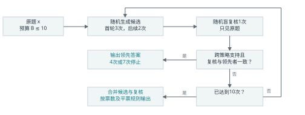
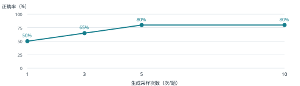

# 有限预算下的随机化求解

## 1 问题、模型与实验边界

选择20道Python 3程序输出预测题，组合有限状态更新、列表别名、闭包、生成器、递归与控制流。答案是确定的整数及列表/元组输出，没有浮点误差或随机输入。被测模型请求型号为 **gpt-5.6-luna**，推理档位 **low**；不用Deep Research或Extended Thinking。

通过Codex CLI临时会话逐题调用，每次新上下文，只输入题目与策略提示，禁用所有工具。离线解释器仅事先产生标准答案及事后评分，求解器与复核器都看不到标准答案。3道简单预检全部答对后，冻结20道组合题，正式采样后不换题。

## 2 随机性改变解题行为

普通推理将提示词分词，根据上下文计算下一token的分布，逐步解码至停止。本实验不声称能控制平台未暴露的temperature/top_p；可控随机性在**提示策略选择**：逐步跟踪、分段归纳、依赖与别名分析、分支边界审查。以种子20261014每四次无放回洗牌，避免预算集中在一种思路。

另从逐行记账、陷阱重推、分段复算中随机选择**盲复核**提示。复核器只看原题，不看候选或票数。不同策略可能暴露遗漏的状态更新，盲复核可减轻跟随多数答案的锚定；但策略标签不同不保证实际推理不同。

## 3 RandomizedSolve 伪代码

```text
RandomizedSolve(x, B=10):
  C = []; V = []; used = 0
  for m in [3, 5, 7]:
    while len(C) < m:
      if used == B: return FinalVote(C, V)
      C.append(LLM(x, RandomGeneratorStrategy()))
      used += 1
    if used == B: return FinalVote(C, V)
    v = LLM(x, RandomBlindCheckStrategy())
    V.append(v); used += 1
    if used == B: return FinalVote(C, V)
    a = UniquePlurality(C)
    t = 2 if m == 3 else 3
    if a exists and Count(C,a) >= t
       and StrategySupport(C,a) >= 2 and v == a:
      return a
  return FinalVote(C, V)
```

C为生成答案，V为盲复核答案。FinalVote合并全部合法回答取相对多数；平票先取最早的复核答案，再取最早生成答案。格式失败耗费预算但不投票，全部失败输出FAIL。早停只读当前前缀，不查看后续答案或标准答案。一般预算B≤10时，达到B即按同一决胜规则输出。

## 4 流程与真实实验结果



| 方案（20题） | 正确题数 / 正确率 | 平均调用次数 |
|---|---|---|
| Single Run | 10/20 · 50% | 1.00 次/题 |
| Fixed Sampling-3 | 13/20 · 65% | 3.00 次/题 |
| Fixed Sampling-5 | 16/20 · 80% | 5.00 次/题 |
| Fixed Sampling-10 | 16/20 · 80% | 10.00 次/题 |
| Your Method（随机策略+盲复核） | 18/20 · 90% | 6.25 次/题 |

公平比较：各方案共享同一随机策略生成池的前缀；Fixed Sampling也使用该策略池，隔离考察固定投票与“复核+自适应分配”的差别，未额外做同一提示词重问对照。1/3/5/10次投票平票均取先出现者。

正式实验实际采集235次新上下文单题回答，含200次固定生成和35次盲复核；每方案每题分别计预算。Your Method在4/7/10次停止的题数为 11/3/6。不是将整场比较声称为每题总共10次。

## 5 1 → 3 → 5 → 10次：收益是否单调？



固定采样的正确率为 50% → 65% → 80% → 80%，各段变化为 +15、+15、+0 个百分点。本样本整体未下降，但不能推出任意题目或更大预算都单调改善。本样本后段增益不大于前段；20题每题占5个百分点，不能据此估计平滑的收益规律。

本样本未观察到相邻预算由对变错，也没有10次生成全错题。理论上新增错误票可以挤掉正确答案；这是可能性说明，不能当成实测案例。来源：验证/实验结果.json，2026-10-14正式20题。

## 6 从逐题结果看成功与失效

## 复核有效：Q20（异常控制流）

生成池10个答案仅2个完全正确，固定10次投票仍错。本方法取前7个生成答案，再盲复核3次，其中2次复核正确，最终在10次预算内答对。例如n=4时10//(n-2)应为5，多个错误回答写成20。它说明增加一种复算过程可以提供有用证据，但一次成功不能保证复核总有效。

## 仍然失败：Q15（生成器表达式绑定）

生成池10个答案有2个正确；本方法取前7个生成答案与3次盲复核（0次复核正确），用满10次仍错。标准输出第二行为[[], [13], [13, 18]]；最终却选为[[], [14], [14, 19]]。该差异与a.pop()后仍使用len(a)=4相符，这是对输出的解释，不能断定隐藏推理的唯一原因。

本方法与Single Run的比较：10/20 → 18/20，正确题数提高；改对8题、改错0题。本样本没有错误早停，但早停正确性不能由一致性保证。随机化可能有效的条件是正确解能够出现，不同策略的遗漏能互相纠正；若所有策略与复核器共享误解，一致性也可能锁定错误。相对固定10次，本方法正确率高10个百分点、平均少3.75次调用；相对固定5次则多1.25次，体现可靠性与预算的取舍。

## 7 10次调用是否等于10次独立试验？

新上下文消除了显式对话历史，却仍共享模型参数、训练知识、系统提示与同一题目。生成策略的无放回轮换本身也不是同分布独立采样。重复同错只提供相关错误的线索，不能由此证明不独立；本实验没有估计相关系数或声称显著性。

增大差异的方法：随机选择状态表示与检查顺序，复核时隐藏候选并从原题重算。策略标签不同不保证思路不同，模型复核也不是可靠的外部判定器。本实验未分别消融复核、停止和平票规则，未做多种子重复实验；调用数亦不等同于token费用。

## 8 最后思考

二者都通过随机选择改变执行路径，并在有限预算内汇总证据。经典随机化算法通常能明确随机位的分布，对独立性和误差作假设或证明；大模型采样依赖共享参数、提示与解码机制，重复调用可能沿用同一误解。新上下文不等于独立正确性事件。关键不是多试几次，而是让随机性改变解题行为，并用复核和停止规则合理分配预算。
